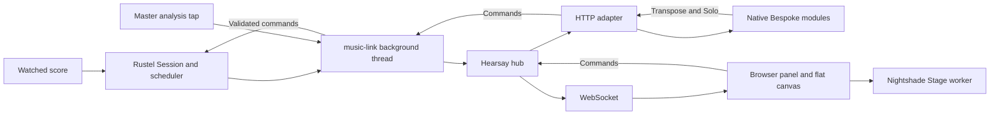

# Architecture and protocol

## Data ownership

Rustel evaluates, schedules and renders the score. The bridge observes existing
scheduler output; it does not query a second prediction window.



Bespoke and Nightshade are independent clients. Native drawing uses Bespoke's
vector API. Browser flat/audio views run on the page thread, independently of
the GPU worker.

## Thread boundaries and bounds

| Component | Responsibility |
| --- | --- |
| Rustel audio callback | Existing sound rendering and bounded analysis tap. No socket I/O or FFT is added here. |
| Rustel producer | Copies lane/onset metadata, applies overlays and analyzes copied audio. |
| Bridge thread | Tokio/Hearsay connection and encoding. Latest-value snapshot/audio slots; bounded 64-entry command and response channels. |
| Hub | TCP 9612, WebSocket 9613, HTTP 9614, all loopback. Registry capped at 64 sessions; snapshots expire after 3 seconds and audio after 1 second. |
| Bespoke network thread | Shared polling and queued commands; UI/audio callbacks do not perform network I/O. |
| Browser Stage | At most 64 lanes, 2,048 input events and 1,024 allocated note blocks. Rejects nonfinite event values; uses nonsingular retired transforms. |

Rustel retains at most 2,048 events. Snapshot publication is throttled to roughly
50 ms and audio analysis to roughly 33 ms. These are producer intervals, not
latency guarantees. Visual cycle time is extrapolated locally and is approximate.

## Topics and schema

| Topic | Payload |
| --- | --- |
| `music/snapshot` | Session, generation, cycle, CPS, lanes, events, full source, nullable `solo_lane`. |
| `music/audio` | Latest waveform, spectrum and stereo analysis frame. |
| `music/command` | Request ID, session, generation, lane and transpose or Solo. |
| `music/response` | Request ID, acceptance and message. |

The authoritative Rust types are in `music-link/src/lib.rs`. Version is currently
1; new optional fields use serde defaults where appropriate. A published schema
versioning policy is still an upstream design decision.

A session ID belongs to one process/session lifetime. Generation identifies the
current score. Lane IDs can survive edits through Rustel's existing lane table;
they are scoped to the session and do not survive process restarts.

Lane entries contain `id`, `label`, `source`, `line` and `transpose`. Snapshot
`source` is the exact full document. Event `context` ranges are UTF-8 byte offsets
into that document, not character positions or offsets into a reconstructed lane.
Ranges must be associated with their matching generation.

Events carry `id`, `lane`, `cycle`, `duration`, optional `original_pitch`/`pitch`,
`sound`, `gain`, `context` and numeric `controls`. Time values are floating-point
cycles. Full Hap whole/part arcs, continuous haps and transformation provenance
are not represented. Control curves connect values resolved at note onsets;
they do not continuously query LFOs.

## Commands and acknowledgements

Read real identifiers and generation from a current snapshot before constructing
a command. These identifiers are illustrative placeholders:

```json
{"request":"transpose-example","session":"CURRENT_SESSION","generation":1,"lane":"#0","semitones":7}
```

```json
{"request":"solo-example","session":"CURRENT_SESSION","generation":1,"lane":"#0","solo":true}
```

Absent `solo` means transpose. `solo:true` replaces the session-wide solo lane.
`solo:false` clears it only if it still names that lane, so a delayed release
cannot clear another lane's newer solo. Solo never changes transpose offsets.
Removing the soloed lane clears it. Stale session/generation commands are rejected.
HTTP clients POST `/transpose` or `/solo`; browser clients publish over WebSocket.

Transpose applies an absolute semitone offset to numeric or note-name `note`
and positive numeric `freq`. Scale-degree `n`, chord lists and arbitrary temporal
transformations are not implemented. Solo filters playback after populating the
full visualization snapshot, so other lanes remain discoverable. It respects
what the evaluated score already includes, including score-authored mute/solo.

Both overlays affect newly scheduled events. Queued notes, sustained voices and
effect tails may finish. Solo is shared across clients, has no ownership lease,
and remains until cleared, the lane disappears or the session ends.

## Audio analysis

Frames include session, generation, sequence, stream ID, epoch, end frame, sample
rate and device time. Device time is end frame divided by sample rate, not wall
clock time. The producer publishes 512 scope samples, 512 dB spectrum bins and
bounded left/right pairs. Consumers reject stale/mismatched frames.

Scope uses rising-edge alignment. Spectrum uses logarithmic display bands,
smoothing and peak hold. Vectorscope shows mid/side and stereo correlation. The
feed is the master tap before master gain/limiting. Display gain is visual only;
per-lane taps and spectrogram history remain future work.

## Renderer recovery

Flat views pause GPU rendering. Worker errors appear in the HUD. Missing frame
statistics for ten seconds (thirty at startup) switch music mode to Piano roll;
reload restarts the worker. Flat and audio views also work without WebGPU.
This is tested recovery, not proof that the originally reported driver freeze
has been reproduced or eliminated everywhere.

## Review before upstreaming

Resolve the shared crate's home, explicit license and pinned dependency strategy;
remove sibling-path assumptions. Review the typed `Event.telemetry` observation and private host-lane context
against the existing trace API contracts. Assess producer allocations/copies, command arbitration, reconnect lifecycle,
source-size bounds and loopback-only trust assumptions. No sound playback stream
is transported; audio messages contain analysis data only.

## Typed telemetry boundary

The bridge now reads typed scheduler observations before events become JSON
reports. It no longer inserts or removes `__rustel_context` in a control object,
and ordinary note values no longer receive `__rustel_lane`.

```text
Hap host lane context + source locations
    -> ScheduleTraceEvent at queue acceptance
    -> optional Event.telemetry
    -> music bridge observes typed values and applies overlays
    -> ordinary OnsetEventJson conversion
```

`Hap::with_lane_context` stores private provenance in the existing shared context
keys; it preserves locations, values and direct live-control bindings. The
pattern operation moves owned haps instead of using a mapper that clears slider
bindings. Context merges retain the provenance with the other typed metadata.

`Scheduler::set_telemetry_enabled` opts drained events into an optional boxed
`ScheduleTraceEvent`, using the same source-range and display-text bounds as the
editor trace API. The observer does not drain, enable, disable or steal the
editor's trace queue. The trace queue's cap and drop counters remain independent.
When telemetry is disabled, that optional observation is absent. There is no
extra pattern query or networking on the scheduling/audio callback path.

The bridge reads cycle and duration directly from typed rational timing and reads
numeric controls from Rustel Values. A zero transpose offset borrows ordinary
control maps without changing them. Transpose and Solo act before report JSON
conversion; the external snapshot/command schema is unchanged, so the existing
Bespoke and Nightshade clients remain compatible.

The older `__rustel_lane` key remains only where existing plugin routing needs
it. Plugin routing compatibility is separate from external observation and was
not replaced by a new routing implementation in this refactor. Score-owned
unknown controls, including a score's own `__rustel_context` field, are preserved.
