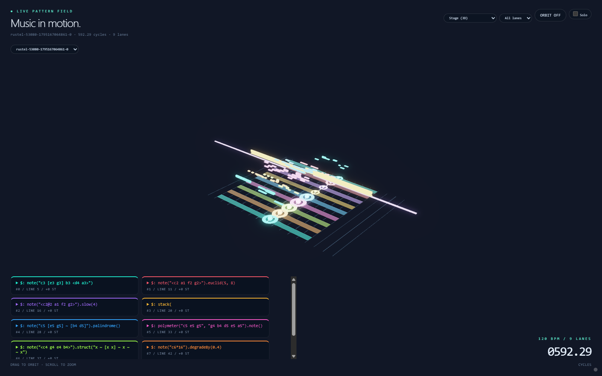
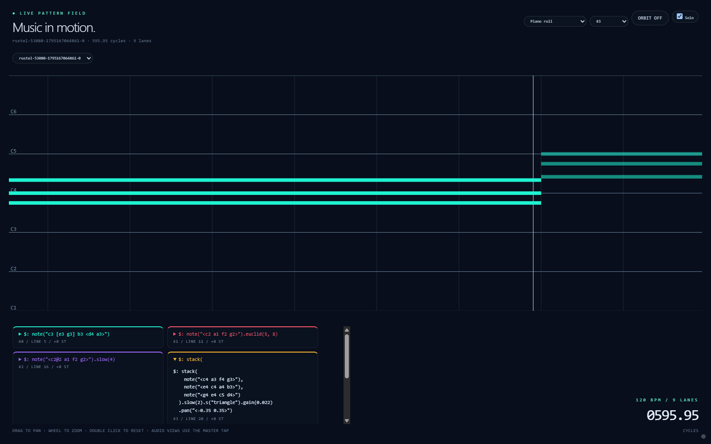
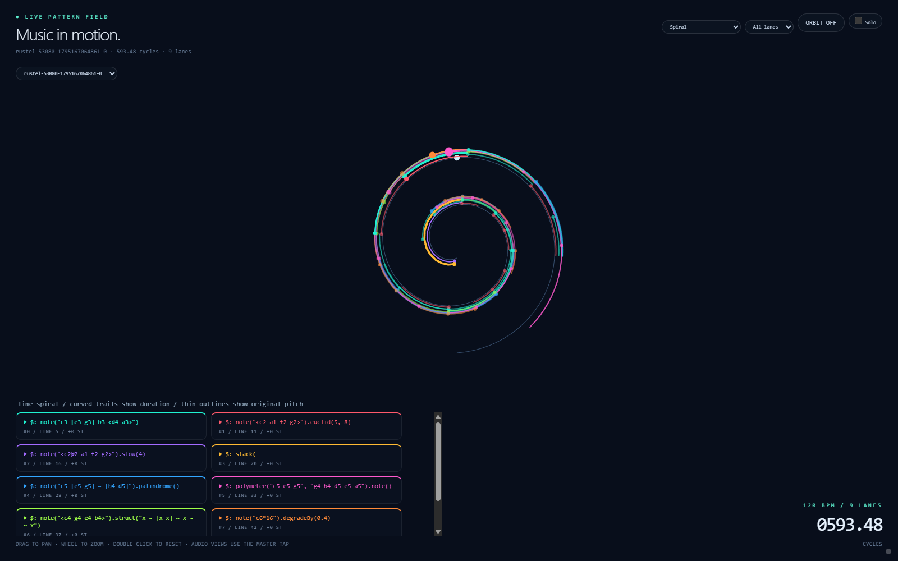
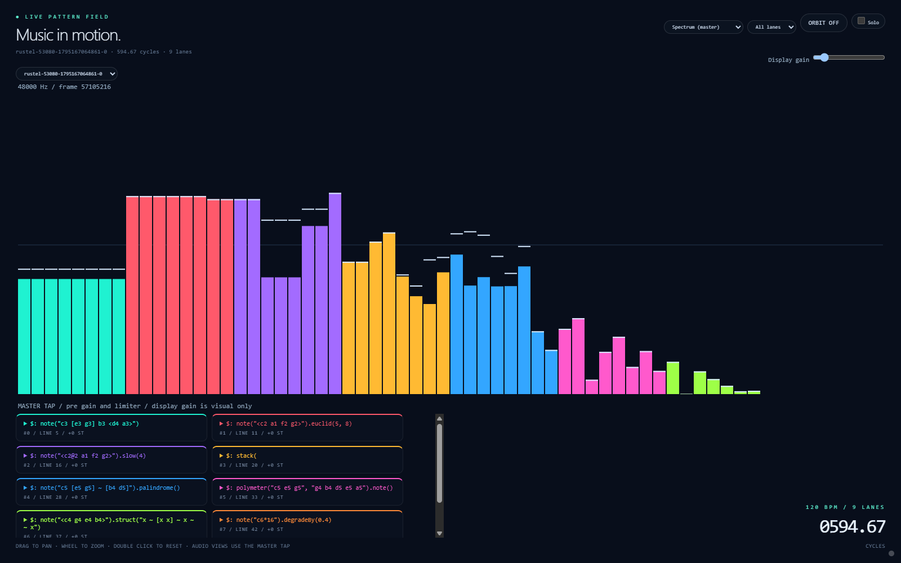

# Live Rustel patterns in Bespoke and Nightshade

This experimental integration lets Bespoke discover lanes from an independently
running Rustel session, visualize their events and source, transpose a lane
through nodes, and audition a selected lane with Solo. Nightshade provides an
independent viewer over the same telemetry. Rustel continues to render sound.

The Windows prototype works with sibling checkouts. Packaging the shared schema
and completing each repository's required checks remain prerequisites for
independent upstream PRs.

## Implemented behavior

- Session discovery and stable lane identities within a running session.
- Full source, onset timing, pitch, gain and exact source-context byte ranges.
- Native Bespoke `rustelpattern`, `rusteltranspose` and resizable `rustelview`.
- Stage, Piano roll, Wordfall, Spiral, Pitch wheel, Scope, Spectrum, Vectorscope
  and Control curves in both viewers. Event-view details vary by renderer.
- Solo in both viewers: changing lanes while soloed moves audition; unchecking
  it restores normal playback. Other lanes remain available for visualization.
- Master audio analysis and onset-sampled gain, pan, cutoff and resonance.
- Generation-checked command acknowledgements and multiple session selection.

The native module draws with Bespoke's own renderer; it does not embed Nightshade.
Source-trace checkboxes have been replaced by Solo. Native source-token
highlighting remains available.

## Solo and complete lane source

Lane `#3` is a three-voice `stack`. The expanded source preserves the complete
method chain. Solo changes playback in Rustel, rather than only filtering the
picture. Already queued notes and effect tails may finish.

## Time spiral

The browser spiral follows Bespoke's mapping: time controls angle and outward
progression; pitch adds a small radial offset. Curved trails show duration and
heads pulse on onsets. Pitch wheel instead has twelve pitch-class directions
and octave-dependent radius.

## Master analysis

Audio views measure Rustel's existing master tap before master gain and limiting.
Selecting a lane does not isolate its audio tap; Solo can change the sound
reaching the master. Display gain changes only the picture.

## Contribution material

- [Architecture and protocol](ARCHITECTURE.md)
- [Reproduction and checks](REPRODUCING.md)
- [Upstream discussion and PR drafts](UPSTREAM.md)
- [Verification evidence](EVIDENCE.md)
- [Screenshot captions](SCREENSHOTS.md) and [visual gallery](index.html)
- [Source and image manifest](manifest.json) and [captured demo](demo.strudel)

All ten images are actual current Nightshade captures, not mockups. Native
Bespoke screenshots are pending: the Windows capture helper failed to initialize,
and the isolated built-in screenshot attempt produced no image. Do not label
browser images as native Bespoke screenshots.

Nothing has been posted to GitHub or sent to maintainers.
