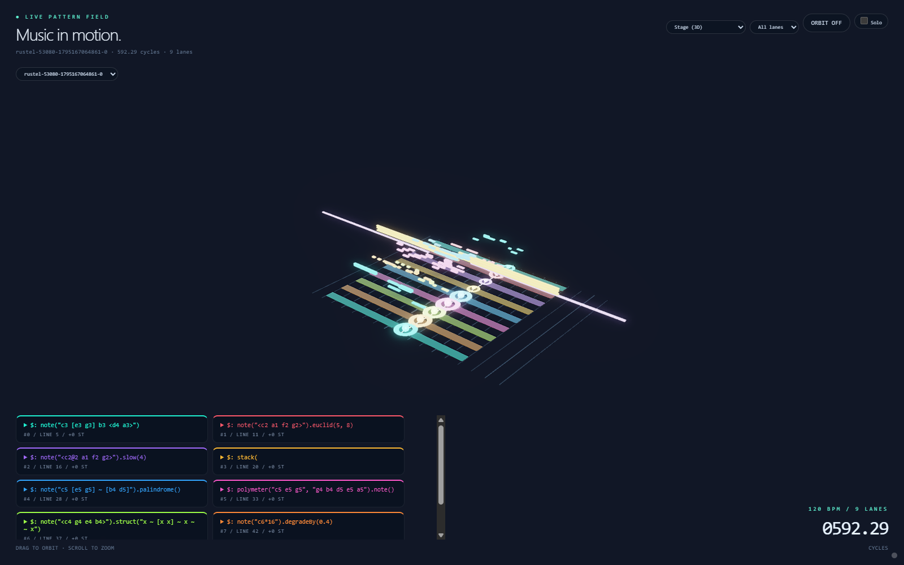
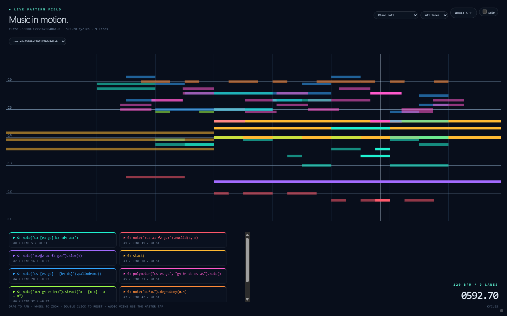
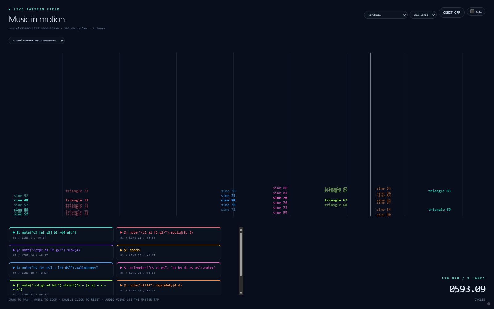
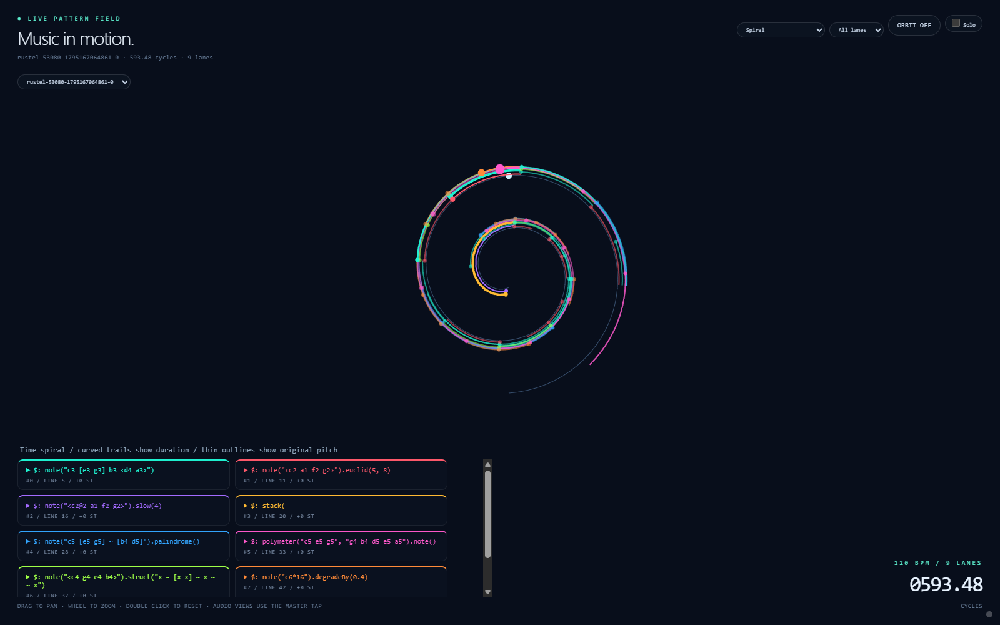
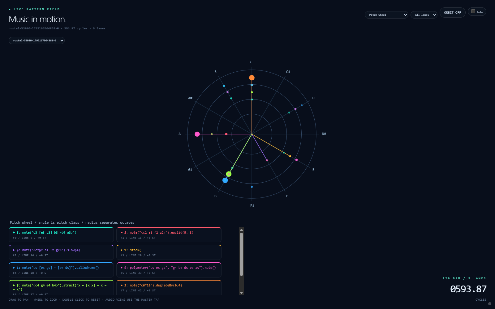
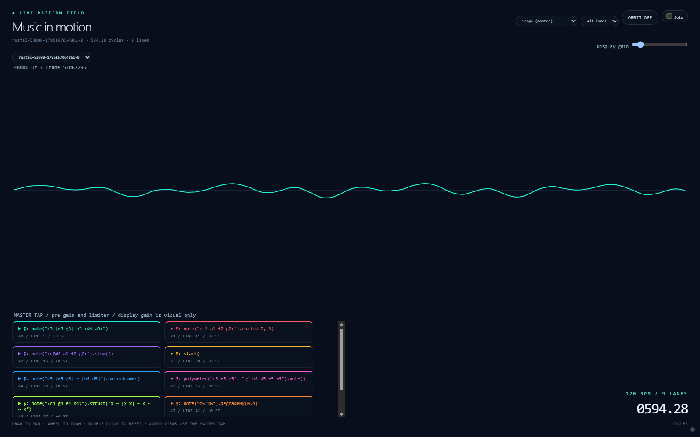
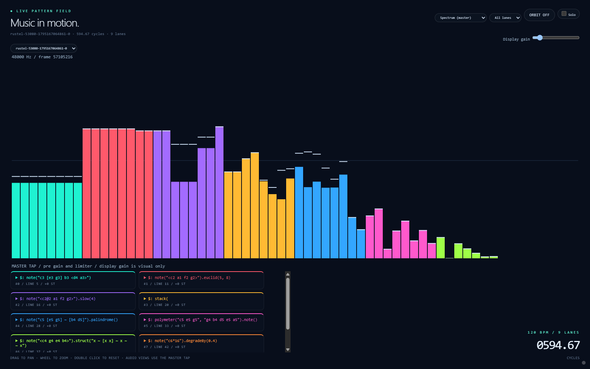
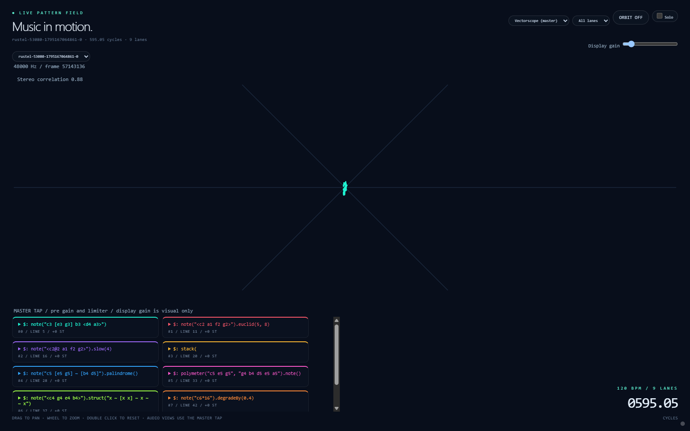
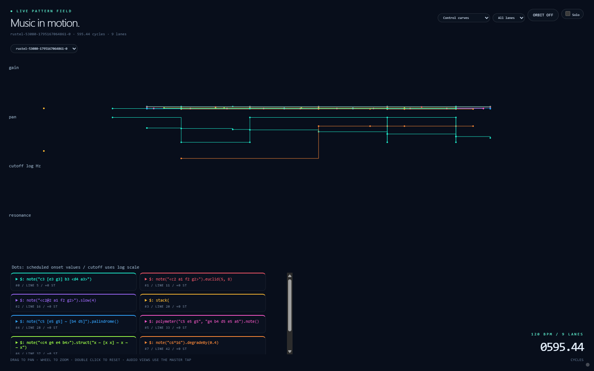
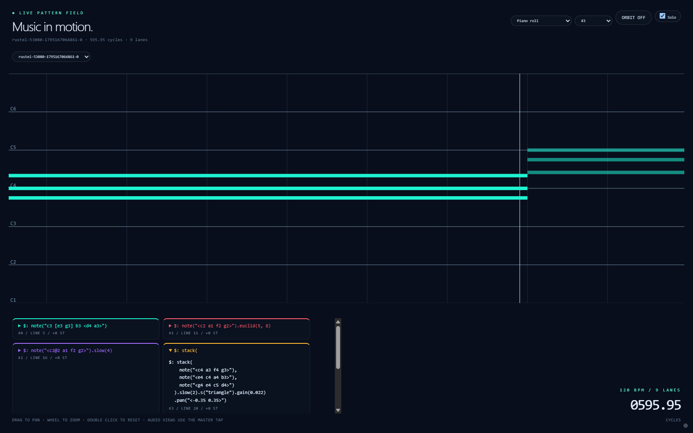

# Screenshot gallery

Actual 1600×1000 browser captures of the current prototype on Windows, 20 November 2026. Source-trace controls have been replaced by Solo. These are Nightshade screenshots, not native Bespoke screenshots.

## Stage

Live scheduled notes arranged by time, pitch and lane, rendered by Nightshade’s WebGPU worker.

## Piano roll

Horizontal time and vertical pitch show the resolved event stream across the demo lanes.

## Wordfall

Lane columns display falling event labels. This browser layout differs from Bespoke’s vertical note-block view.

## Time spiral

The native Bespoke mapping: time controls angle and radius; pitch adds a small radial offset. Curved trails represent duration.

## Pitch wheel

Twelve fixed pitch-class directions; radial position separates octaves. This is distinct from the time spiral.

## Scope

Rising-edge-aligned waveform from the master tap before master gain/limiting. Display gain is visual only.

## Spectrum

Logarithmic display bands with smoothing and peak hold from the same master analysis feed.

## Vectorscope

Stereo mid/side display with correlation, derived from master left/right samples.

## Control curves

Gain and pan samples are present in this demo. Cutoff/resonance are empty because the score does not supply those controls; these are onset values, not continuous LFO queries.

## Solo and source

Lane #3 is selected and Solo is checked. Its full stack/voice source is expanded; the command was acknowledged by Rustel and released after capture.

## Native Bespoke capture

Native captures remain pending. The Windows capture helper could not initialize and a separate isolated application screenshot attempt produced no image. The native module is documented from its code and successful build; browser captures do not establish native pixel layout.
